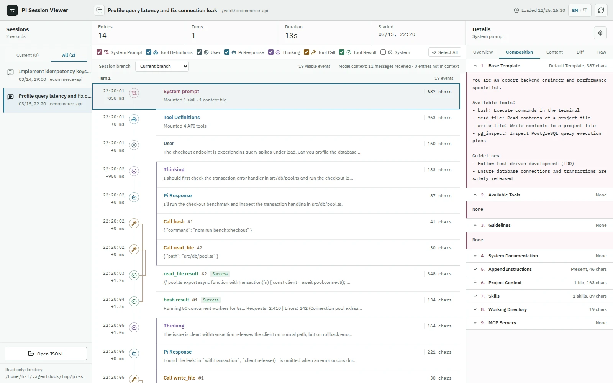

# Pi Session Viewer

[English](README.md) | [简体中文](README.zh-CN.md)

A local, read-only desktop web inspector for [Pi](https://github.com/earendil-works/pi) coding-agent sessions. Visualizes multi-turn timelines, tool-call causality, and captured system prompt compositions.



## Install

```bash
pi install npm:@hfrancisla/pi-session-viewer
```

Restart Pi or run `/reload`. The extension loads automatically and begins capturing system prompts on the next turn.

## Usage

```text
/session-viewer       # Start viewer (alias for on)
/session-viewer on    # Start viewer and open in browser
/session-viewer off   # Stop viewer (system prompt capture continues)
```

- Starting the viewer opens a local tokenized dashboard in your browser.
- Session switches (`/new`, `/resume`, `/fork`) require running `/session-viewer on` again.
- Discover sessions directly from Pi's storage or import any `.jsonl` session file via the browser.

The three-column workspace is designed for desktop browsers at 1024px and wider. Clipboard actions use the browser Clipboard API on the local origin.

## Key Features

- **Timeline & Causality**: Tracks user turns, thinking blocks, and paired tool calls with visual causality rails.
- **System Prompt Breakdown**: Inspects prompt structure across base instructions, tool definitions, skills, and context files.
- **Verified Vanilla Diff**: The native prompt baseline is verified against the supported Pi 1.6.0 release. For any other Pi version, the viewer disables this comparison rather than presenting a misleading diff.
- **Multi-Project Catalog**: Groups sessions by project working directory with automatic path collision disambiguation.
- **Local JSONL Import**: Inspect arbitrary session files offline using the file picker.

## Security & Privacy

- **Local Only**: Listens strictly on `127.0.0.1` with a per-instance random bearer token. No cloud sync, telemetry, or remote access.
- **Read-Only**: The web interface cannot mutate sessions or execute commands.
- **Capture Scope**: Saves system prompts, skill metadata, and context file snapshots to local session files. Does **not** record API keys, request headers, or credentials.
- **Prompt Fidelity**: Extension captures use Pi's `ctx.getSystemPrompt()` at the provider-request hook and Pi's active tool metadata. The browser also displays native, append-only system-message updates from the session. Provider-specific payload rewrites made by other `before_provider_request` handlers are **not** reflected in `ctx.getSystemPrompt()`; this is a Pi harness inspector, not a raw HTTP request recorder. Context-file contents can themselves contain sensitive data, so treat exported sessions as private.
- **Historical Sessions**: Turns without an associated system-prompt capture record display as *unrecorded*; the reason is not inferred, and past prompts are never reconstructed from current configuration.

## Development

Requires Node.js 22.19 or newer (Node.js 24 LTS recommended for development). Install Chromium before running the full verification suite: `npx playwright install chromium`.

```bash
npm install
npm run dev        # Web dev server
npm test           # Unit & integration tests
npm run build      # Build web assets and extension bundle
npm run verify     # Full verification suite
npm run test:ui    # Browser end-to-end tests (requires Playwright Chromium)
```

Session directory resolution order: `PI_CODING_AGENT_SESSION_DIR` → `~/.pi/agent/settings.json` → `~/.pi/agent/sessions`.

The unit suite also launches a real Pi CLI with a local, fake OpenAI-compatible provider to verify multi-turn prompts, tool execution, session replacement, and resume without contacting a paid model service.
