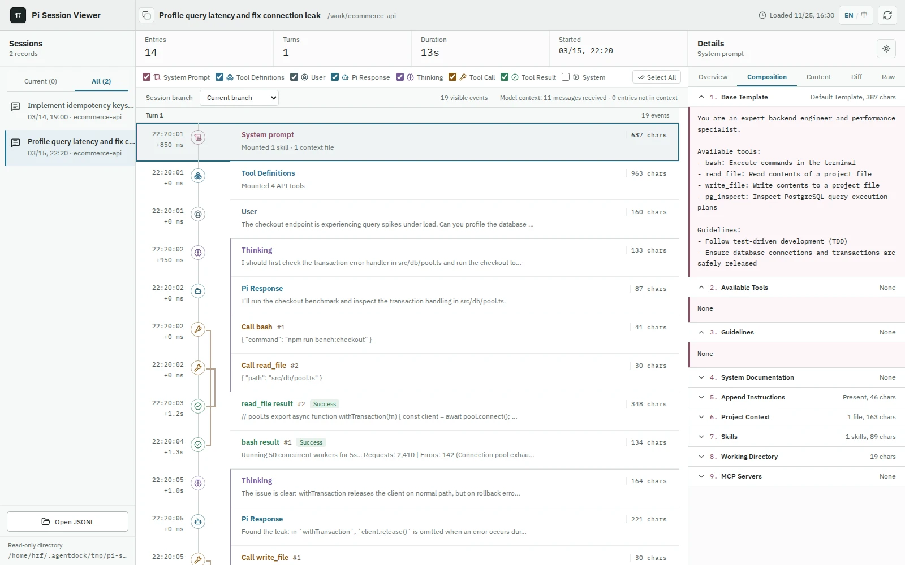

# Pi Session Viewer (Pi 会话分析)

[English](README.md) | [简体中文](README.zh-CN.md)

为 [Pi](https://github.com/earendil-works/pi) 编程助手量身打造的本地只读会话可视化与系统提示词（System Prompt）分析面板。直观呈现多轮时间轴、工具调用因果链以及原生持久化系统状态。



## 安装

```bash
pi install npm:@hfrancisla/pi-session-viewer
```

重启 Pi 或执行 `/reload`。扩展将自动加载，并在下一轮对话起开始记录必要的补充观测。

## 使用方法

```text
/session-viewer       # 启动面板（等同于 on）
/session-viewer on    # 启动面板并在浏览器中打开
/session-viewer off   # 关闭面板（补充观测仍继续工作）
```

- 启动面板后会在浏览器中打开带有独立访问令牌的本地仪表盘。
- 切换会话时（`/new`、`/resume`、`/fork`），需重新执行 `/session-viewer on`。
- 直接从 Pi 本地存储发现会话，或通过浏览器导入任意 `.jsonl` 会话文件。

三栏工作区面向宽度不小于 1024px 的桌面浏览器，复制操作使用本地来源的浏览器 Clipboard API。

## 核心特性

- **时间轴与调用因果链**：清晰呈现用户轮次、Thinking 推理块及配对工具调用，并带有调用时序因果导轨。
- **原生系统状态**：按分支历史位置重放提示词分区与工具声明，区分未知和明确空状态。
- **历史差异**：比较同分支相邻已知状态，包含工具新增、替换、删除。
- **多项目会话目录**：按工作目录归类会话，并对重名目录进行自动路径消歧。
- **离线 JSONL 导入**：支持直接选取本地会话文件进行离线分析。

## 安全与隐私

- **仅限本地访问**：严格监听 `127.0.0.1`，并为每次启动生成独立的 Bearer Token。无云端同步、无遥测上报、无远程访问。
- **只读设计**：Web 界面无法修改会话或执行任何终端命令。
- **补充观测**：仅记录明确的 Harness 强制提示词及工具注册来源，关联已完成的 Assistant 回合。不读取请求标头、凭证或完整 Provider payload。
- **分析边界**：原生持久化状态和中间观测均不代表最终 Provider 请求；未知历史保持未知。离线不上传文件，完整上下文投影仅在服务端可用。

会话文件由 Pi 管理，Viewer 不使用独立数据库；会话目录和响应缓存仅驻留内存。开发服务和独立服务会在终端输出带访问令牌的启动链接。

`npm run check:sessions` 对照 Pi 原生投影验证系统状态重放，报告未知状态和解析诊断。不修改原始 JSONL。

## 本地开发

需要 Node.js 22.19 或更新版本（开发推荐 Node.js 24 LTS）。完整验证前执行 `npx playwright install chromium`。

```bash
npm install
npm run dev        # Web 开发服务器
npm test           # 单元与集成测试
npm run build      # 构建 Web 静态资产与扩展产物
npm run verify     # 完整验证套件
npm run test:ui    # 浏览器端到端测试（需安装 Playwright Chromium）
```

会话目录查找顺序：`PI_CODING_AGENT_SESSION_DIR` → `~/.pi/agent/settings.json` → `~/.pi/agent/sessions`。

单元测试中还会启动真实 Pi CLI，连接本地模拟的 OpenAI 兼容提供商，验证多轮提示词、工具执行、会话新建与恢复，不调用收费模型服务。
